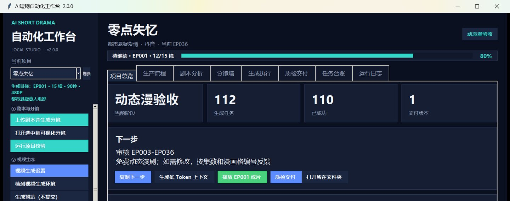
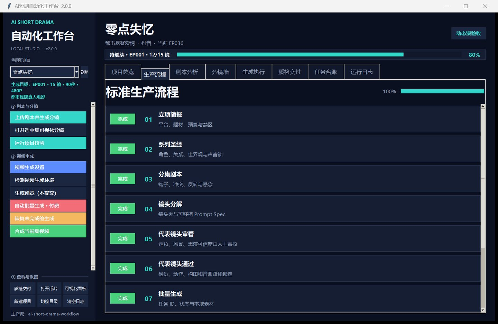
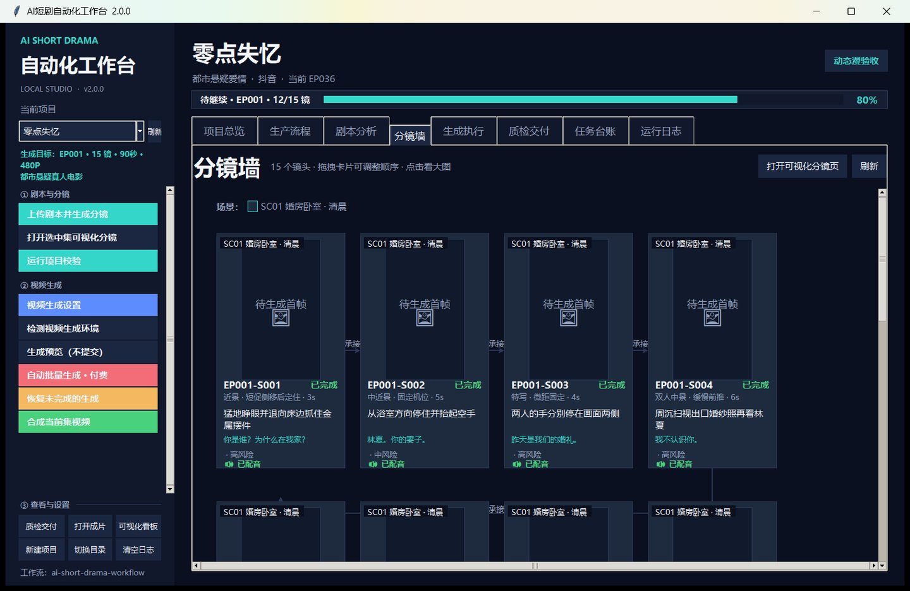
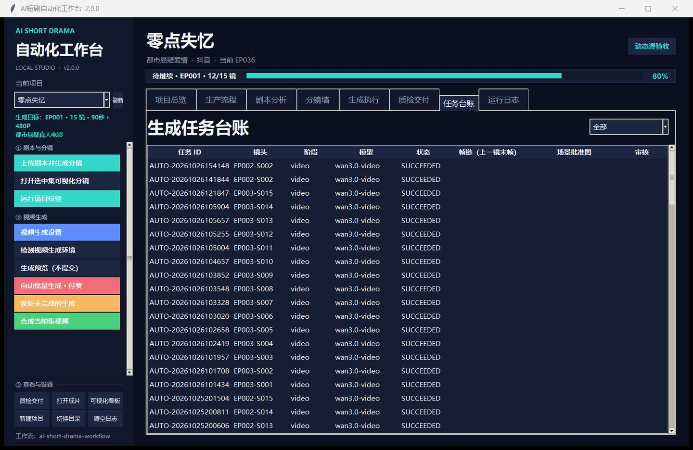

# AI 短剧自动化工作台 · 项目展示

> 一个把「AI 短剧」从剧本做到可交付成片的本地优先桌面工作台。
> **本仓库是项目展示页：功能说明 + 真实界面截图。源码私有，可按需申请查看。**

Python 3.9 · Tkinter(ttk) · FFmpeg · OpenCV · MediaPipe · 单机本地运行

---

## 一句话说清它是什么

市面上的「AI 出片工具」大多只解决「生成一个镜头」。真正做一集短剧，难的是**一致性、可追溯、可返工**：
角色的脸不能漂、场景不能串、台词要贴上口型、每镜时长要卡在模型能接受的范围、
某镜废了要能只重跑那一镜、交付要有登记。

这个工作台把 10 个生产阶段和 8 个功能页签固化进桌面应用里，让每一步都有明确的输入、产物与通过条件，
并且任何一镜都能回查「用的哪个模型、任务号是多少、什么时候出的、质检结论是什么」。

## 真实界面

**项目总览**：当前阶段、累计生成任务数、成功数、交付版本数，以及「下一步该干什么」。
数字直接从项目目录的文件和台账里统计出来，不是手动填的。

**生产流程**：10 个阶段的可视看板。完成度**不是手工打勾**，而是按项目目录里真实存在的产物反推——
没有分镜表就永远是 0%，避免「自己骗自己已经做完了」。

**分镜墙**：整集镜头以卡片网格铺开，缩略图、镜号、运镜、台词、配音状态与风险标记放在一起看，
一眼能判断这集哪里还缺、哪里要重跑。拖拽卡片即可调整镜头顺序。

**任务台账**：每一镜的生成任务都在这里——任务 ID、阶段、模型、状态、上一镜衔接帧、场景批准图、审核结论。
这一页是整个「可追溯」的落点。

## 它具体做了什么

| 能力 | 说明 |
| --- | --- |
| 10 阶段流水线 | 立项简报 → 系列圣经 → 分集剧本 → 镜头分解 → 代表镜头审看 → 锁定 → 批量生成 → 剪辑声音 → 整集质检 → 发布复盘 |
| 人工闸门 | 代表镜头不通过就不许批量生成，避免把「脸漂、场景串」的镜头复制 200 遍再返工 |
| 任务台账与断点续跑 | 提交即落 `task_id`，`resume` 按台账续跑，已完成的跳过、失败的单独重提，不重复计费 |
| 并发控制 | 1–4 并发可调，避免打爆服务商限流 |
| 单镜时长约束 | 按模型实测能力把单镜锁在 4–8 秒，超限在规划阶段就告警，而不是等 400 |
| 口型对齐 | MediaPipe FaceMesh 逐帧测嘴部开合度（MAR）定位「嘴在动」的窗口，配音按窗口起播；无 mediapipe 时退回 OpenCV ROI 差分 |
| 音画不拉伸 | 台词长于窗口时用 `atempo` 压缩音频，不拉伸画面（拉伸会让动作变形） |
| Token 控制 | 单镜只带本镜行 + 引用到的角色/场景 + Prompt Spec；剧本分析与模型档案按内容指纹缓存 |
| 本地优先 | 数据全部是 project 目录下的可读 JSON / CSV，没有数据库，没有云控制台 |

## 工程取舍（为什么这么设计）

1. **不做数据库。** 一集短剧的数据量很小，换成 SQLite 反而让「人类/AI 直接接手」变难。
   落成 `01_bible / 02_script / 03_storyboard / 05_generation / 07_qc / 08_release` 六个阶段目录，
   用编辑器或 AI 都能直接改。
2. **先落台账再等结果。** 云端生成是分钟级的，把 `prediction_id` 先写盘，
   才敢让「关掉界面」变成安全操作。
3. **缓存按内容指纹。** 剧本分析、模型能力档案都只认内容，改一个字才重算，避免反复烧 Token。
4. **只做编排，不代付、不内置模型。** 凭据留在使用者本机，未配置时相关按钮直接禁用，不静默失败。

## 仓库说明

- 本仓库**只包含文档与截图**，用于展示项目与我个人的实现思路。
- 源码为私有仓库，招聘 / 技术交流场景可以联系我申请只读查看（见 GitHub 主页）。
- 项目不含任何模型权重、API 凭据、素材与成片。

## 关于

作者：林伟楠 · 全栈 / 桌面应用 / AI 工作流
如果这个项目对你有帮助，欢迎在 Issues 里交流流水线设计。
