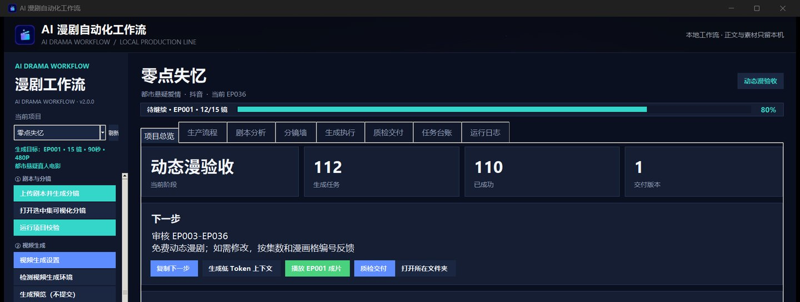

# AI 漫剧自动化工作流 · 项目展示

> 把一部竖屏漫剧从「剧本」推到「可交付成片」的本地桌面工作台。
> **本仓库是展示页：功能说明 + 真实界面截图。源码私有，可按需申请查看。**

Python 3.9 · PySide6（外壳）· Tk/ttk（生产内核）· FFmpeg · OpenCV · MediaPipe · 单机本地运行

---

## 一句话说清它是什么

市面上的「AI 出片工具」大多只解决「生成一个镜头」。真正做一集漫剧，难的是**一致性、可追溯、可返工**：
角色的脸不能漂、场景不能串、台词要贴上口型、每镜时长要卡在模型能接受的区间、
某镜废了要能只重跑那一镜、交付要有登记。

这个工作台把 **10 个生产阶段**和 **8 个功能页签**固化进桌面应用，每一步都有明确的输入、产物与通过条件，
任何一镜都能回查「用的哪个模型、任务号是多少、什么时候出的、质检结论是什么」。

**这一版是单页桌面应用**：PySide6 外壳只承载「漫剧生产线」一页，不再挂电商与星河两个工作区。
生产内核仍跑在独立 Tk 进程里，由外壳通过原生窗口句柄挂载——两侧不共享事件循环，
切页不丢状态，内核崩了也不拖垮外壳。

## 生产流程：10 个阶段

完成度**不是手工打勾**，而是按项目目录里真实存在的产物反推：没有分镜表就永远是 0%，
避免「自己骗自己已经做完了」。阶段推进本身就是一个状态机，每一项都要过闸门才往下走。

## 分镜墙：整集摊开看

镜头以卡片网格铺开，缩略图、镜号、运镜、台词、配音状态与风险标记放在一起，
一眼判断这集哪里还缺、哪里要重跑；拖拽卡片即可调整镜头顺序。

## 任务台账：可追溯的落点

每一镜的生成任务都在这里——任务号、阶段、模型、状态、上一镜衔接帧、场景批准图、审核结论。
任务号在提交瞬间就落进本地台账，界面崩了、断网了，重开还能接着查、接着跑。

## 关键实现

| 能力 | 做法 |
|---|---|
| 状态机 + 六项闸门 | 视频存在 / 时长合规 / 配音存在 / 台词匹配 / 帧链连续 / 场景一致 |
| 异步提交与断点续跑 | 提交即写 `task_id`，失败安全停止，重开可续；并发 1–4 可调 |
| 单镜时长 4–8 秒 | 模型对 9 秒直接拒绝，边界收敛在配置层而不是散落在调用处 |
| 配音为时间基准 | MediaPipe FaceMesh 逐帧测嘴部开合（MAR）定位嘴动窗口，超长台词用 `atempo` 压缩 |
| 字幕 | 按停顿 > 0.5s 切分，输出 SRT / ASS 并烧录 |
| Token 控制 | 剧本分析内容指纹缓存、单镜上下文只带本镜行与引用路径、提示词去重限长 |
| 交付登记 | 逐镜结论写入 `release-manifest.csv` |

## 边界说明

- 不内置模型权重、不代付模型费用；模型服务由使用者自行配置，密钥只留本机。
- 只做编排、调度、校验与打包，不伪造生成结果——生成失败就是失败，会停在台账里等人处理。
- 数据只落本地 JSON / CSV，不依赖数据库与云控制台。

## 许可

本仓库内容（文字与截图）许可见 `LICENSE`：可阅读、可引用（注明出处），
转载、商业使用需取得书面许可。软件本身为私有源码，另行授权。
